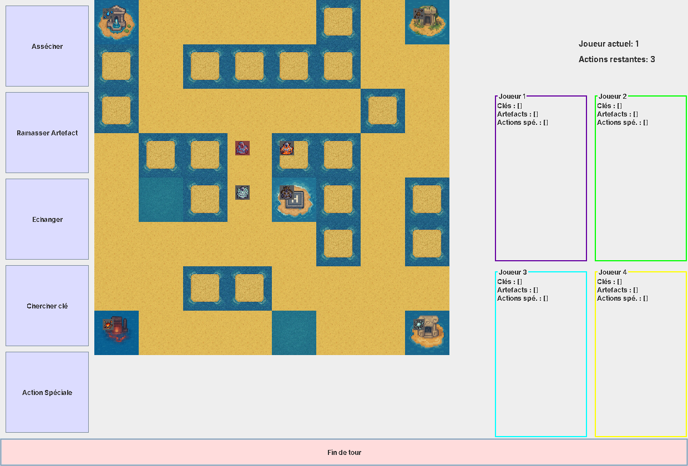

# Projet-Ile-Interdite-Java

> Ma version jouable du jeu de société *L'Île interdite* en Java/Swing, avec une architecture Modèle-Vue-Contrôleur.

## Contexte

- **Cours** : Programmation Objet et Génie Logiciel (POGL), L2 double diplôme Informatique-Mathématiques (LDD IM), Université Paris-Saclay
- **Année** : 2024-2025, projet rendu fin avril 2025
- **Équipe** : j'ai réalisé ce projet en binôme avec **Matias Lievain–Paredes**

Le code de `src/` est publié **tel qu'il a été rendu**. Le rapport d'origine se trouve dans [`RAPPORT.txt`](RAPPORT.txt) et les diagrammes de classes dans [`docs/`](docs/).

## Ce que fait le projet

Quatre joueurs coopèrent sur une île de 8×8 cases qui s'enfonce peu à peu sous l'eau. L'héliport est au centre et quatre temples (Eau, Feu, Terre, Vent) sont dans les coins, chacun avec son artefact.

À chaque tour, le joueur actif a 3 actions :

| Action | Effet |
|---|---|
| Flèches du clavier | se déplacer d'une case (sauf vers une case submergée) |
| **Assécher** | remettre à sec une case inondée : la sienne ou une voisine |
| **Ramasser Artefact** | prendre l'artefact du temple où l'on se trouve, si l'on a 4 clés de cet élément |
| **Echanger** | donner une clé à un joueur qui est sur la même case |
| **Chercher clé** | tirage au sort : rien, une clé, sa case s'inonde, ou une action spéciale |
| **Action Spéciale** | *sac de sable* (assécher n'importe quelle case) ou *hélicoptère* (aller sur n'importe quelle case, en emmenant des joueurs) |
| **Fin de tour** | 3 cases au hasard montent d'un niveau d'eau, puis on passe au joueur suivant |

Une case passe de **normale** à **inondée**, puis à **submergée**. Un joueur dont la case est submergée doit fuir vers une case voisine ; s'il ne peut pas, il se noie.

- **Victoire** : tous les joueurs sont sur l'héliport avec les 4 artefacts.
- **Défaite** : un joueur se noie, l'héliport est submergé, ou un temple est submergé avant qu'on ait pris son artefact.

## Capture



*Vraie sortie du programme, capturée en novembre 2026 après 8 clics sur « Fin de tour ». Les cases de sable entourées d'eau sont inondées ; les cases d'eau seule sont submergées. Les 4 panneaux « Joueur » à droite viennent du remplacement écrit après le rendu (voir « Limites connues »).*

## Techniques utilisées

- **Architecture MVC** (le cœur du cours) :
  - `modeles/` contient l'état du jeu : la grille `IleModele` de `Zone`, `JoueurModele` et `ObjetModele`, ainsi que des `enum` pour les types de case, les états d'inondation, les éléments et les actions spéciales ;
  - `controleurs/` contient les règles : `IleControleur` (recherche de clé, fin de tour, victoire et défaite) et `JoueurControleur` (déplacement, assèchement, ramassage, don de clé, hélicoptère) ;
  - `vues/` contient l'affichage Swing : `IleVue` (fenêtre, boutons, clavier, souris), `JoueurVue` et `ObjetVue`.
- **Affichage en calques** avec un `JLayeredPane` : le plateau, puis les artefacts, puis les joueurs, chacun dessiné dans `paintComponent`.
- **Cache d'images** (`ImageManager`) : chaque image est chargée une seule fois et gardée dans une `HashMap`. Si une image manque, un carré magenta la remplace.
- **Événements Swing** : `ActionListener` en lambda pour les boutons, `KeyAdapter` pour les flèches, `MouseAdapter` pour choisir une case, et des boîtes de dialogue modales (`JDialog`, `JComboBox`, `JCheckBox`) pour le don de clé et l'hélicoptère.
- **Grille 2D** : voisins en 4-connexité (haut, bas, gauche, droite), avec vérification des bords.
- **Hasard** (`java.util.Random`) : une recherche de clé a 1 chance sur 5 de donner une clé, d'un élément tiré au hasard parmi 4. Les 3 inondations de fin de tour visent des cases tirées au hasard.

## Lancer le projet (Mac)

Il faut un JDK, version 8 ou plus récente. À l'époque, nous utilisions Amazon Corretto 11. Aucune bibliothèque externe n'est nécessaire : voir [`requirements.txt`](requirements.txt).

```bash
# 1. Vérifier si Java est installé
java -version
# Sinon, installer un JDK, par exemple Temurin 11 depuis https://adoptium.net
# ou avec Homebrew : brew install --cask temurin@11

# 2. Compiler, depuis le dossier du projet
javac -encoding UTF-8 -d build $(find src reconstruction-apres-rendu -name '*.java')

# 3. Lancer (src est ajouté au classpath pour que les images soient trouvées)
java -cp build:src Main
```

Il faut bien inclure `reconstruction-apres-rendu/` à la compilation : la raison est expliquée ci-dessous.

> Astuce : les flèches du clavier ne marchent que si le plateau a le focus. Si un déplacement ne répond pas, cliquez sur un bouton puis réessayez.

## Ma contribution

D'après notre rapport, nous avons travaillé à deux en même temps, en partageant le code dans IntelliJ, chacun sur des aspects différents et en s'entraidant. Nous n'avons pas noté de répartition plus précise, et aucun fichier ne porte de nom d'auteur. Je ne m'attribue donc pas de partie précise. Je connais l'ensemble de l'architecture et des règles implémentées, et je peux les expliquer.

## Limites connues

Je les documente sans les corriger, pour que le code reste tel qu'il a été rendu.

- **Fichier manquant.** La classe `vues.composants.JoueurInfoPanel`, qui affiche le panneau d'information de chaque joueur, n'a jamais été poussée sur le dépôt GitLab du cours. `IleVue.java` l'importe, donc **le code tel que rendu ne compile pas seul**. Le diagramme de classes prouve qu'elle existait, avec les champs `joueur` et `numeroJoueur`. Un remplacement minimal a été écrit après le rendu (novembre 2026), avec l'aide d'une IA (Claude), dans le dossier séparé [`reconstruction-apres-rendu/`](reconstruction-apres-rendu/). Son apparence n'est pas celle d'origine.
- **L'hélicoptère est réutilisable à l'infini** quand on emmène d'autres joueurs : il n'est retiré de l'inventaire que si l'on voyage seul.
- **Après une fuite déclenchée par « Fin de tour »**, le joueur actif ne change pas. Il faut recliquer sur « Fin de tour », ce qui inonde 3 cases de plus.
- **Assécher** décompte l'action dès le clic sur le bouton, même si l'on clique ensuite sur une case invalide.
- **« Echanger » est un don** : la clé passe d'un joueur à l'autre, sans contrepartie.
- Dans `verifierDefaite`, le test « un joueur est mort » renvoie `false` au lieu de `true`. C'est sans effet en pratique, car la noyade est gérée par un autre chemin.
- **Le MVC n'est pas strict** : `IleVue` (874 lignes) contient une bonne part de la logique de jeu (états « assécher », « fuir », gestion des actions spéciales). Avec le recul, ces états devraient être dans un contrôleur.
- **Le jeu est très difficile à gagner** : il faut au moins 16 clés, avec une seule recherche par tour. Le rapport le signale déjà, ainsi que des cas de défaite non détectés (joueur isolé sans chemin vers l'héliport).
- **Origine des images** : les sources exactes n'ont pas été notées à l'époque (voir « Crédits »).

## Crédits

- **Sujet** : le jeu à implémenter et ses extensions (« Vraie aventure ») viennent de l'énoncé de l'équipe enseignante de POGL. Il s'inspire du jeu de société *L'Île interdite* (*Forbidden Island*, Gamewright). L'énoncé n'est pas inclus dans ce dépôt.
- **Images** :
  - les 3 textures de sol (`solNI`, `solI`, `solS`) ont été générées avec ChatGPT, et leur certificat de provenance (C2PA) est conservé dans les fichiers ;
  - les autres images ont été en partie générées par IA et en partie trouvées sur internet (probablement les personnages). Les sources exactes n'ont pas été conservées.
- **Après le rendu** : le fichier de `reconstruction-apres-rendu/`, le README et le nettoyage du dépôt ont été réalisés en novembre 2026 avec l'aide d'une IA (Claude). Le code de `src/` n'a pas été modifié.
- **Aide extérieure** : comme indiqué dans le rapport, certaines parties (notamment `ImageManager`, les `JComboBox` et les `JDialog`) ont été écrites en s'aidant de la documentation Java et d'exemples trouvés en ligne.
